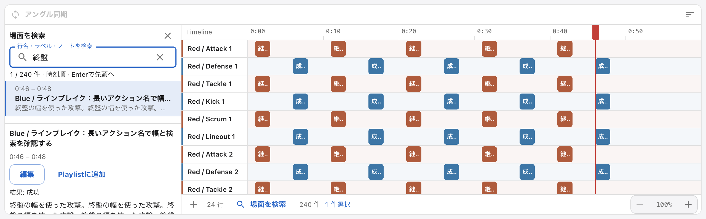

# SporTagLytics

[](https://opensource.org/licenses/MIT)
[](https://github.com/Kou-ISK/sportaglytics/releases)

スポーツ映像のタグ付け、同期再生、統計可視化、プレイリスト作成を行う Electron デスクトップアプリケーションです。現在の主な利用想定はラグビー分析ですが、タイムラインとラベルを中心にした設計のため、他競技への応用も見込んでいます。

まずは[合成サンプルで試す](docs/quickstart.md)から、映像を開き、タグを編集し、保存・再開とクリップ出力を体験できます。自分の試合映像やAIモデルは不要です。

**v0.17.10以降**では、旧SporTagプロジェクトも共通の「パッケージを開く」から開きます。既知の旧構造はバックアップを残して元の場所・名前へ更新し、以前の編集コピーの引継ぎとバックアップ復元にも対応します。SportscodeのEdit List XMLは映像・秒数補正を明示して別プロジェクトへ取り込みます。ネイティブ `.scpkg` / `.sczip` は未対応です。[対応形式と復旧手順](docs/package-compatibility.md)を参照してください。

ソースの変更が既存installerへ反映されたとは限りません。公開版の配布物は[Releases](https://github.com/Kou-ISK/sportaglytics/releases)、変更は[CHANGELOG](CHANGELOG.md)、配布時の確認項目は[Release手順](.github/RELEASE.md)で確認できます。

## OSSとAIモデルの公開範囲

アプリ本体は[MIT License](LICENSE)のOSSです。イベント検出の学習・評価・exportはprivate R&Dに分離し、アプリは外部model packを利用します。Paintの既製モデルは別ライセンスで同梱し、文章AIのGGUFは利用者が用意します。アプリのMITは、これらの重みや学習動画へ一括適用されません。

[モデルカード・配布台帳](docs/model-distribution.md)に、3系統の取得先、学習・評価の確認済み事項、未確認の出所・許諾・再現性をまとめています。コードOSSと全学習データの公開は別であり、学習素材の再配布を前提にしません。

配布済みの告知修正と、素材・モデル・互換形式の由来に残る判断は[由来の確認台帳](docs/provenance-review.md#現行配布と次版候補の確認状態)を参照してください。独自アイコンのAI生成という申告と、生成時の利用条件を裏付ける資料は区別して記録しています。MIT表示やCI成功だけで素材・モデルの権利確認を完了とは扱いません。

## 主な機能

- **マルチアングル同期再生**: 最大8アングル・各16クリップのローカル映像またはYouTube映像を共通タイムラインで再生
- **ライブキャプチャ**: USB/HDMI・OS対応のiPhone・IP映像を最大4入力まで録画し、通常のタイムラインでコーディング（[接続条件と操作](docs/live-coding.md)）
- **カスタマイズ可能なタグ付け**: 自由配置のボタンレイアウトとホットキー
- **リアルタイム統計分析**: ダッシュボード、モメンタム、クロス集計
- **文章AI（別途GGUFが必要）**: Timeline・ラベル・メモ・統計を根拠に、ローカルLLMで回答と推奨クリップを生成。映像フレームの直接判定ではありません
- **自動イベント検出（外部model packが必要）**: ラグビー映像の候補区間をTimelineへ追加する試験機能。公式packの公開取得先は未提供で、通常配布だけでは利用できません。候補は人が確認・修正します
- **プレイリスト・Paint**: フリーズフレーム、選手図形・位置キー編集・対象指定による追尾、描画を含むクリップ書き出し（[操作と制約](docs/tactics.md)）
- **ビジュアルタイムライン**: ズーム、範囲選択、ドラッグ編集、行名・ラベル・ノートからの[場面検索と全文確認](docs/timeline-review.md)
- **多形式エクスポート**: JSON / CSV / SCTimeline
- **独自ファイル形式**: `.stpkg` パッケージ、`.stpl` プレイリスト、`.stcw` コードウィンドウ

## スクリーンショット



2026-10の[合成データによるUX検証画像](docs/reports/2026-10-ux-review.md)です。機種や表示設定による違い、未検証範囲は同記録を参照してください。

## クイックスタート

### インストール

配布物は[最新のRelease](https://github.com/Kou-ISK/sportaglytics/releases/latest)から取得してください。下表の署名状態は[v0.17.10で確認済みの状態](https://github.com/Kou-ISK/sportaglytics/releases/tag/v0.17.10)です。取得する版のRelease本文と、同梱される場合は`release-verification.json`で、その版の検証結果を確認してください。

| OS / CPU                    | 配布物と導入条件                                                                                                                                                         |
| --------------------------- | ------------------------------------------------------------------------------------------------------------------------------------------------------------------------ |
| macOS Apple Silicon / Intel | CPUに合うarm64 / x64 DMG。アプリは署名・公証済みで、最終DMGの内容を検査済み。Homebrewでも導入できます                                                                    |
| Windows 11 x64              | `SporTagLytics-Setup-<version>-x64.exe`。**未署名**のためSmartScreenや組織の実行ポリシーで制限される場合があります。[Windowsの導入条件](docs/windows.md)を確認してください |
| Windows ARM / Linux         | 公式のネイティブ配布はありません                                                                                                                                         |

macOSのHomebrew導入:

```bash
brew tap Kou-ISK/tap
brew install --cask sportaglytics
```

Windows NではH.264書き出し等にMedia Feature Packが必要です。macOSで文章AIを使う場合のllama.cpp要件はIntelで13.3以降、Apple Siliconで14以降です。これは[文章AI runtimeの条件](docs/ai-analysis.md#runtime-boundary)であり、全機能の最低OS検証を示すものではありません。

### 最初の操作

[合成サンプルのクイックスタート](docs/quickstart.md)で、開く → タグの追加・修正 → 保存・再開 → クリップ出力を順に試せます。AIモデル、外部アカウント、自分の試合映像は不要です。

自分の映像を使うときは「新しいパッケージを作成」から基本情報と映像を登録し、複数アングルなら同期点を合わせます。コードパネルのボタンまたはホットキーでイベントを記録し、`Cmd+Shift+A` / `Ctrl+Shift+A`で統計画面を開きます。詳細は[ユーザーガイド](docs/user-guide.md)を参照してください。

## ドキュメント

- [ドキュメント索引](docs/README.md): 利用者、開発者、AI contributor 向けの入口
- [合成サンプルのクイックスタート](docs/quickstart.md): 最初の編集・保存・出力とサンプル再生成
- [ユーザーガイド](docs/user-guide.md): 詳細な使い方
- [Privacy and Data Handling](docs/privacy-and-data-handling.md): ローカル保存、外部送信、AI 分析時のデータ境界
- [開発ガイド](docs/development.md): 開発環境、ワークフロー、品質ゲート
- [Testing and Quality Gates](docs/testing.md): テスト方針と品質ゲート
- [UX実機評価と比較画像](docs/reports/2026-10-ux-review.md): 合成データで確認した用途、改善、未検証範囲
- [システム概要](docs/system-overview.md): 現行アーキテクチャの要約
- [プロジェクト構成](docs/project-structure.md): ディレクトリ構成と新規ファイルの配置判断
- [ADR](docs/adr/README.md): 長期的な設計判断の記録
- [AI Analysis and Local LLM Setup](docs/ai-analysis.md): ローカル LLM セットアップ
- [ドキュメント運用ガイド](docs/documentation-guide.md): docs 更新方針と同期ルール
- [CHANGELOG](CHANGELOG.md): 変更履歴

## 技術スタック

- **フロントエンド**: React 19 + TypeScript 5（解決版はlockfile参照）
- **デスクトップ**: Electron 43
- **UI**: Material-UI 7
- **映像**: Video.js 8
- **パッケージ管理**: pnpm 9.1.0

## 開発

### 必要な環境

- Node.js 22.12.0+
- pnpm 9.1.0（`package.json` の `packageManager`）

### セットアップ

```bash
# pnpmのインストール（未インストールの場合）
npm install -g pnpm@9.1.0

# 依存関係のインストール
pnpm install --frozen-lockfile

# Electronアプリを開発モードで起動
pnpm run electron:dev
```

品質ゲートと変更別の検証は [Testing](docs/testing.md#required-quality-gate)、ネットワーク・OS別の準備は [開発ガイド](docs/development.md#開発環境) を参照してください。

## AI contributor 向け入口

このリポジトリでは `AGENTS.md` を AI 実装規約の正本としています。AI agent / Copilot / human contributor は、実装前に以下を確認してください。

- [AGENTS.md](AGENTS.md): アーキテクチャ、TypeScript、React、Electron セキュリティの必須規約
- [.github/copilot-instructions.md](.github/copilot-instructions.md): Copilot 向けの適用順序
- [ドキュメント索引](docs/README.md): 変更対象に応じた参照先
- [プロジェクト構成](docs/project-structure.md): 新規ファイルの配置判断
- [ADR](docs/adr/README.md): 既存の設計判断

## コントリビューション

コントリビューションの流れは [CONTRIBUTING.md](CONTRIBUTING.md) を参照してください。セキュリティ問題は public issue ではなく [SECURITY.md](SECURITY.md) の手順で報告してください。

## ライセンス

アプリ本体は[MIT License](LICENSE)です。第三者ソフトウェア・モデルの条件は[配布告知](THIRD_PARTY_NOTICES.md)と[モデル台帳](docs/model-distribution.md)を参照してください。

## 謝辞

- [Electron](https://www.electronjs.org/)
- [React](https://react.dev/)
- [Material-UI](https://mui.com/)
- [Video.js](https://videojs.com/)

## トラブルシューティング

- **映像が再生されない**: MP4/MOV & H.264/AAC を推奨。権限/パスを確認。
- **音声同期がずれる**: 両映像に音声があるか確認し、`同期リセット` → `音声同期を再実行`。手動同期/手動モードで微調整可能。
- **タイムラインが反映されない**: `timeline.json` の書き込み権限と残容量を確認。
- **パッケージ読み込みエラー**: `.metadata/config.json` の有無と相対パス変換を確認。
